# Diagramas de flujo de rutas

## Propósito

Este documento muestra, de forma visual y editable, qué ocurre cuando una aplicación consume cada ruta disponible. Es la referencia de comunicación entre la aplicación móvil, el backend y la base de datos.

Los diagramas están escritos con **Mermaid**, por lo que GitHub los muestra como diagramas y cualquier integrante puede actualizar el texto directamente en este archivo. No son imágenes fijas.

**Última actualización:** 14 de octubre de 2026.

## Cómo mantenerlo actualizado

Cuando se cree o cambie una ruta:

1. Actualizar su contrato en `../../openapi/openapi.yaml`.
2. Agregar o ajustar su diagrama en este archivo.
3. Actualizar la aplicación que consume la ruta.
4. Agregar o actualizar pruebas.

La regla es: una ruta nueva no se considera terminada si no tiene contrato, diagrama y prueba.

## Mapa de rutas actual

| Área | Ruta | Estado | Diagrama |
| --- | --- | --- | --- |
| Disponibilidad | `GET /health` | Disponible | [Ver flujo](#1-comprobar-el-servicio) |
| Autenticación | `POST /api/v1/auth/google` | Disponible | [Ver flujo](#2-iniciar-sesión-con-google) |
| Autenticación | `POST /api/v1/auth/refresh` | Disponible | [Ver flujo](#3-renovar-la-sesión) |
| Autenticación | `POST /api/v1/auth/logout` | Disponible | [Ver flujo](#4-cerrar-sesión) |
| Autenticación | `GET /api/v1/auth/me` | Disponible | [Ver flujo](#5-consultar-el-perfil-autenticado) |
| Vehículos | `POST /api/v1/vehicles` | Disponible | [Ver flujo](#6-registrar-un-vehículo) |
| Vehículos | `GET /api/v1/vehicles` | Disponible | [Ver flujo](#7-listar-los-vehículos-de-la-cuenta) |
| Vehículos | `GET /api/v1/vehicles/{vehicleId}` | Disponible | [Ver flujo](#8-consultar-un-vehículo) |
| Vehículos | `PATCH /api/v1/vehicles/{vehicleId}` | Disponible | [Ver flujo](#9-actualizar-información-básica-del-vehículo) |
| Vehículos | `PATCH /api/v1/vehicles/{vehicleId}/vin` | Disponible | [Ver flujo](#10-registrar-el-vin-una-sola-vez) |
| Administración | `PATCH /api/v1/admin/vehicles/{vehicleId}/plate` | Disponible | [Ver flujo](#11-correcciones-administrativas-de-placa-o-vin) |
| Administración | `PATCH /api/v1/admin/vehicles/{vehicleId}/vin` | Disponible | [Ver flujo](#11-correcciones-administrativas-de-placa-o-vin) |
| Vehículos | `DELETE /api/v1/vehicles/{vehicleId}` | Disponible | [Ver flujo](#12-retirar-un-vehículo-de-la-lista) |
| Vehículos | `GET /api/v1/vehicles/active` | Disponible | [Ver flujo](#13-consultar-el-vehículo-activo) |
| Vehículos | `PUT /api/v1/vehicles/active` | Disponible | [Ver flujo](#14-cambiar-el-vehículo-activo) |

> Nota para arquitectura: las cuatro rutas de autenticación se encuentran implementadas en el backend y descritas en `03-auth-service.md`. Su incorporación completa a `../../openapi/openapi.yaml` queda como tarea de sincronización documental.

---

## 1. Comprobar el servicio

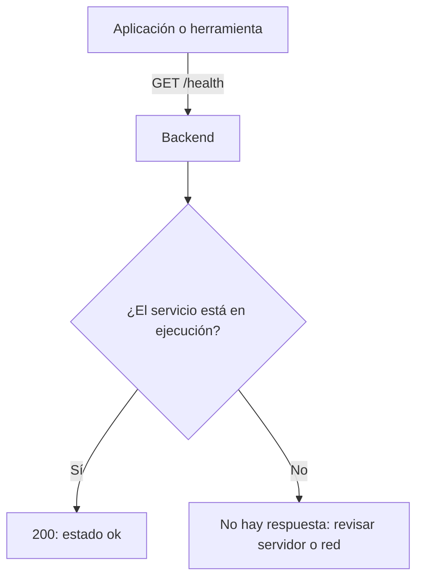

## 2. Iniciar sesión con Google

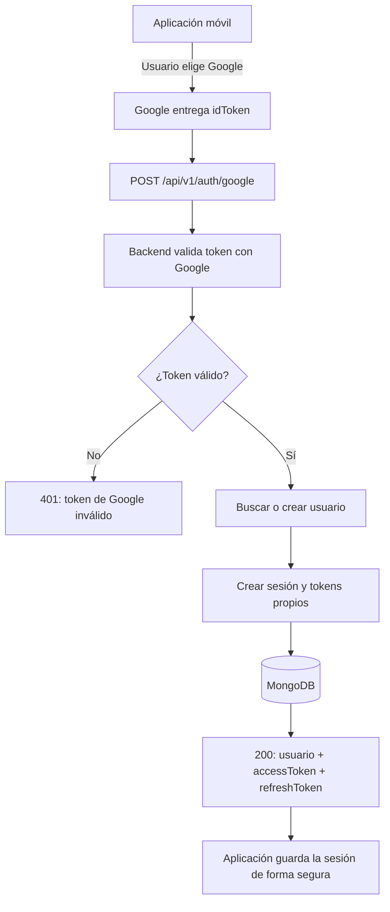

## 3. Renovar la sesión

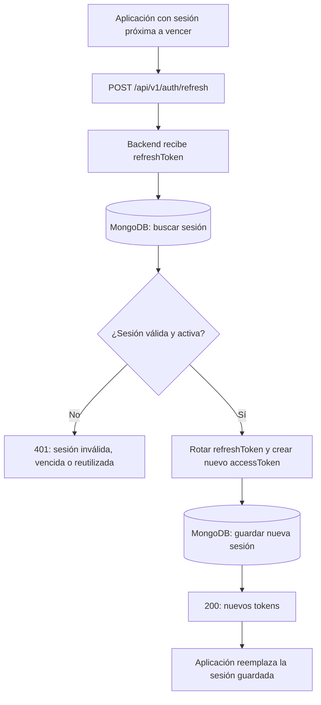

## 4. Cerrar sesión

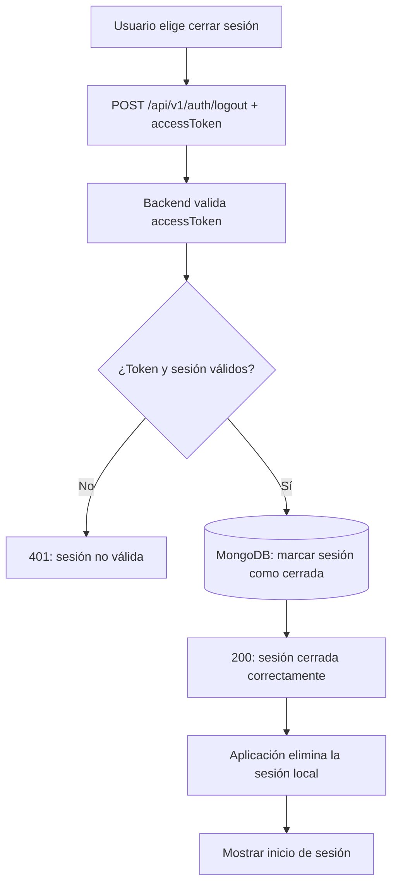

## 5. Consultar el perfil autenticado

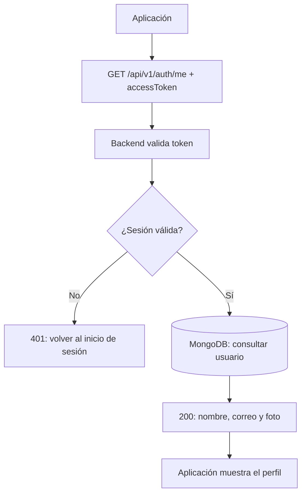

## 6. Registrar un vehículo

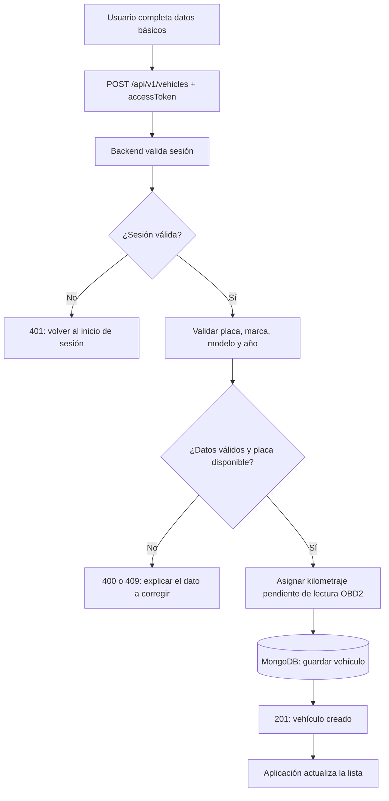

## 7. Listar los vehículos de la cuenta

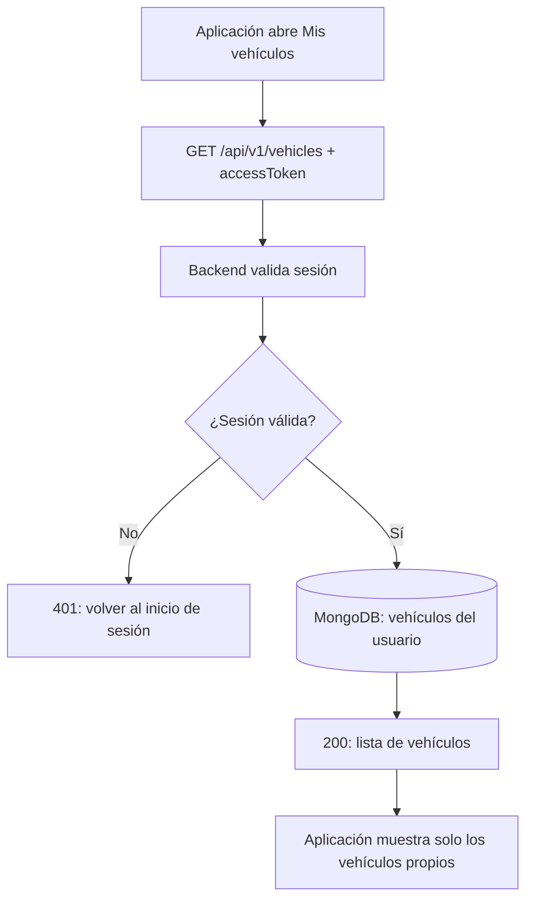

## 8. Consultar un vehículo

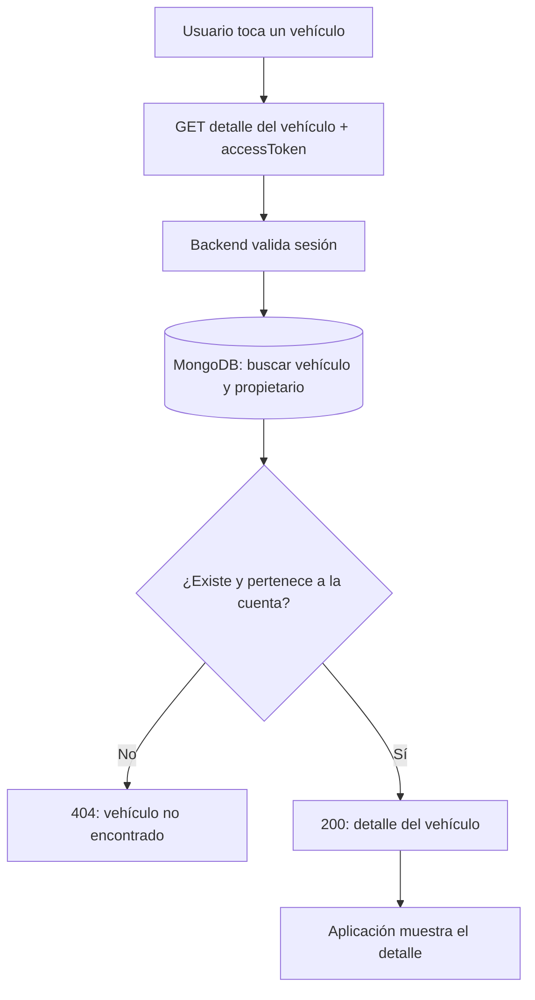

## 9. Actualizar información básica del vehículo

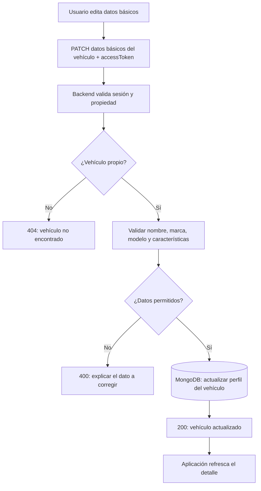

## 10. Registrar el VIN una sola vez

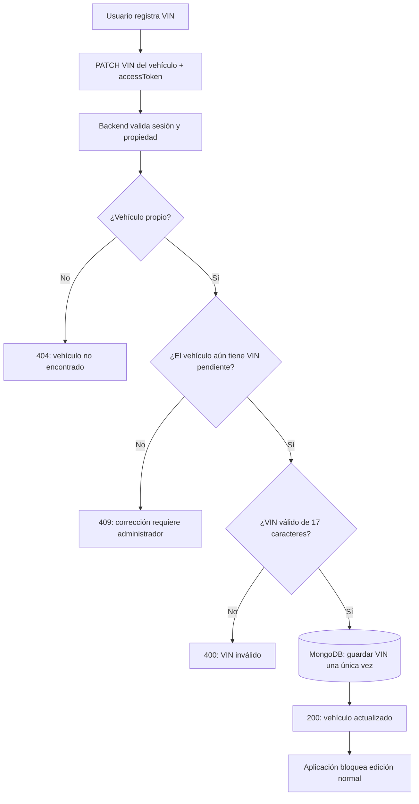

## 11. Correcciones administrativas de placa o VIN

### Placa

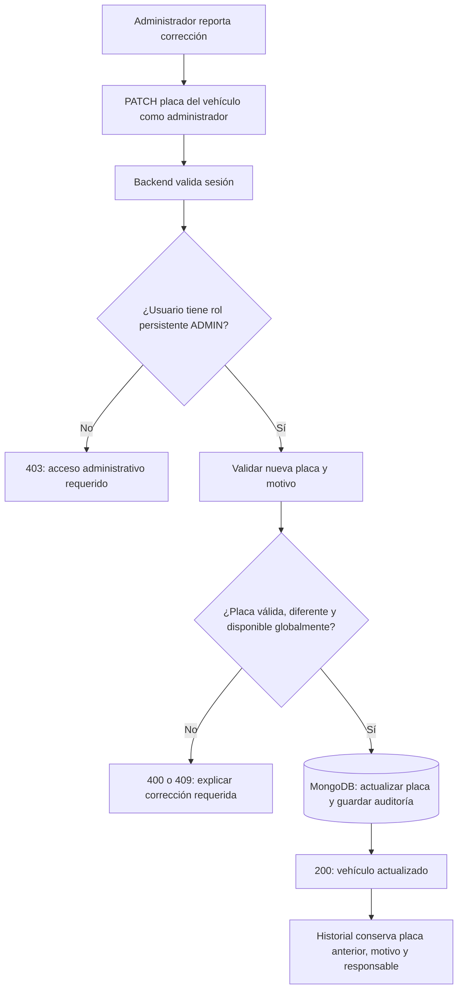

### VIN

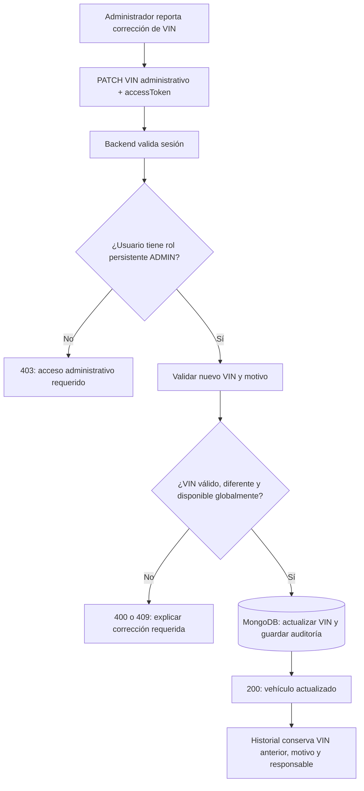

## 12. Retirar un vehículo de la lista

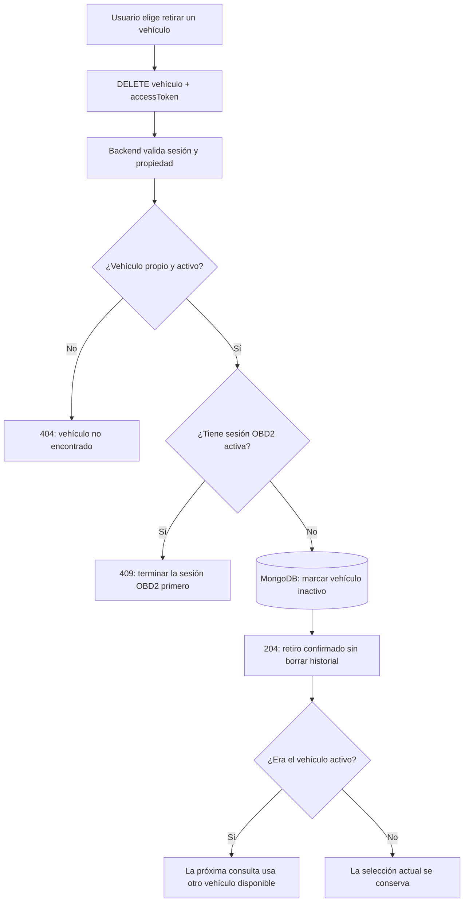

## 13. Consultar el vehículo activo

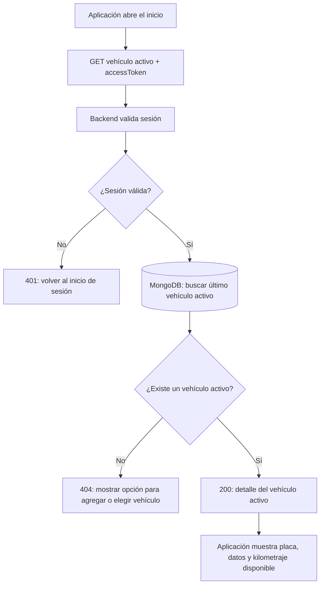

## 14. Cambiar el vehículo activo

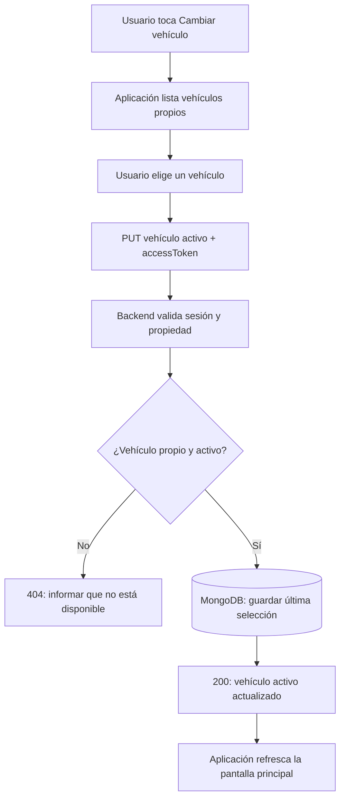

## Próximo diagrama: lecturas OBD2

La siguiente ruta que se agregue para OBD2 deberá incluir su diagrama en esta sección. Antes de definirla se necesita confirmar el adaptador, el tipo de conexión compatible con iPhone y Android, y los datos exactos que puede entregar.
