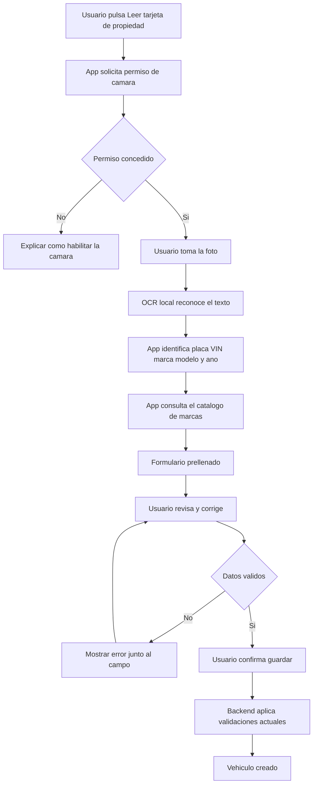

# Diseño: asistencia de lectura de tarjeta de propiedad

## Propósito y alcance inicial

La aplicación permitirá tomar una foto de la tarjeta de propiedad para **proponer** los datos del vehículo. No crea vehículos automáticamente, no modifica VIN existentes y no guarda ni sube la imagen en esta primera versión.

El OCR ocurre en el dispositivo. La persona revisa el borrador y confirma el formulario normal de creación; por tanto siguen vigentes las validaciones de placa, VIN, marca y propiedad del vehículo.

## Contrato del borrador OCR

Este es un contrato interno de Flutter, temporal y sin una ruta HTTP nueva. La foto nunca forma parte del objeto ni se envía al backend.

```json
{
  "source": "PROPERTY_CARD_OCR",
  "plate": "ABC123",
  "vin": "1HGCM82633A004352",
  "brand": "CHEVROLET",
  "model": "ONIX",
  "year": 2022,
  "engine": "1.0 TURBO",
  "confidence": {
    "plate": "high",
    "vin": "medium",
    "brand": "high",
    "model": "medium",
    "year": "high"
  }
}
```

Después de la revisión humana, la app usa los contratos existentes:

- `GET /api/v1/vehicle-brands` para validar y seleccionar la marca activa.
- `POST /api/v1/vehicles` para crear el vehículo confirmado.

## Flujo



## Permisos y privacidad

| Plataforma | Configuración | Finalidad |
| --- | --- | --- |
| Android | permiso `CAMERA` | Tomar la foto dentro de la app. |
| iOS | `NSCameraUsageDescription` | Explicar que la cámara lee datos del vehículo. |

No se solicitarán permisos de galería, almacenamiento, ubicación, contactos ni fotos. La imagen queda temporalmente en memoria y se descarta al confirmar, cancelar o salir. No debe aparecer en registros técnicos, analítica ni peticiones HTTP.

## Reglas de funcionamiento

| Dato | Regla |
| --- | --- |
| Marca | Se convierte a mayúsculas y debe existir como activa en el catálogo. |
| Placa | Se convierte a mayúsculas y conserva la validación de formato y unicidad. |
| VIN | Solo se propone; debe tener 17 caracteres válidos. Si ya existe, el backend bloquea el registro. |
| Datos con baja confianza | Se muestran marcados para revisión; nunca se confirman solos. |
| OCR sin lectura útil | La persona puede diligenciar manualmente el formulario normal. |

## Criterios para implementar

1. La funcionalidad debe probarse con tarjetas anonimizadas y condiciones variadas de luz.
2. Debe funcionar en Android e iOS físicos antes de considerarse terminada.
3. El usuario debe poder corregir o borrar cada dato propuesto antes de guardar.
4. La app debe informar con claridad si el permiso de cámara fue negado, si la lectura falló o si el backend rechaza un dato.
5. Cualquier futura conservación o envío de la imagen requerirá un diseño separado de consentimiento, cifrado, retención y eliminación.
